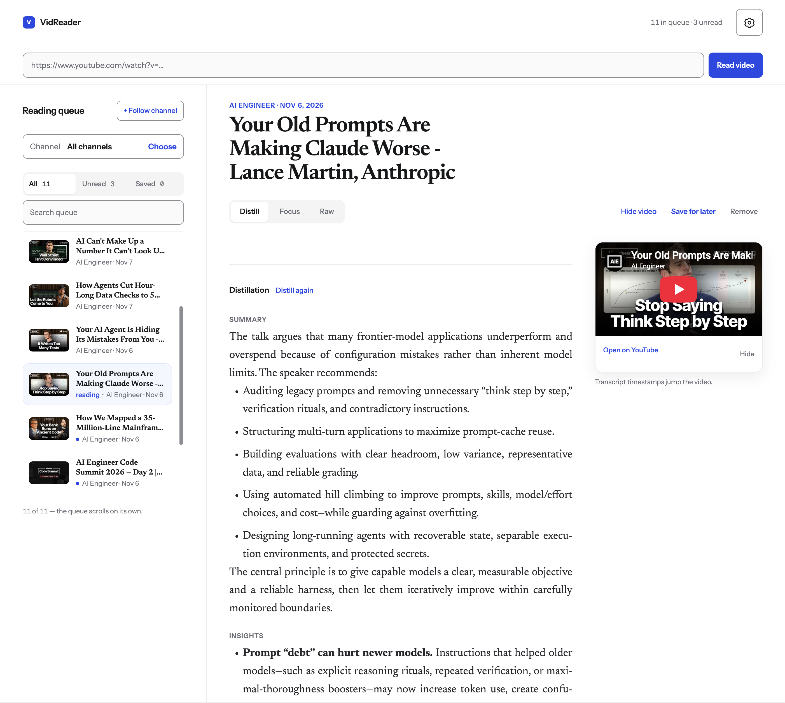

# VidReader

A personal, caption-first video reader. Paste a public YouTube link to read its English captions, follow channels, or choose an AI provider for a distillation. Captions are cached locally. Focus mode keeps the full transcript and can validate an optional AI punctuation pass against the original words.



## Run locally

Install Node.js 24.21.0 or a newer Node.js 24 release, a current Python 3.11 or newer patch release, and a Python virtual environment. The server refuses unsupported Node versions:

```sh
nvm install
python3 -m venv .venv
.venv/bin/python -m pip install --upgrade pip setuptools
.venv/bin/python -m pip install --require-hashes -r requirements.txt
npm ci
npm start
```

Open http://127.0.0.1:4173. `yt-dlp` and its Python dependencies are pinned with hashes in `requirements.txt`. Node supplies its JavaScript runtime.

## Import YouTube subscriptions

Use the **+** button beside **Read video**, then choose **Subscriptions CSV**. Export YouTube subscriptions from [Google Takeout](https://takeout.google.com/settings/takeout/custom/youtube), unzip the archive, and select `subscriptions.csv`. VidReader previews the channel count and skips channels you already follow. Choose **Import subscriptions** to save them in this browser and load their videos. Large imports fetch one channel at a time.

## Local access

VidReader runs on `127.0.0.1:4173` without a login. It accepts connections from the local machine and rejects network clients. Keep it local because its optional integrations use the server owner's credentials. Host and origin checks remain enabled.

## Optional AI

Open **Settings → AI**, choose **My ChatGPT account**, then select **Continue with ChatGPT**. Complete sign-in and allow plan usage in your browser. Eligible accounts can use their ChatGPT plan without an API key. Available models load after connection. **Disconnect ChatGPT** signs out of this app; **Manage usage** opens your ChatGPT usage settings.

The connection stays on this computer in `~/.config/vidreader`, encrypted with a key in the OS credential store. macOS uses Keychain, Windows uses Credential Manager, and Linux requires an unlocked Secret Service. Sign-in stops if secure storage is unavailable. It does not use or change your saved Codex login.

This sign-in flow is for the local app. Remotely hosted deployments need separate OpenAI access. Claude remains available through its API-key option. See [OpenAI's local-app guide](https://developers.openai.com/siwc/token-sharing-open-source) and the [DevKit provenance and license](vendor/README.md).

AI actions run only when you choose one. API keys entered in settings stay in the browser's session storage, stored separately for each provider, and are sent to the local server for that provider's request. Session providers use the server owner's existing local credentials. Closing or reloading the tab cancels pending AI requests and stops subsequent cleanup chunks.

## Check and share the source

```sh
npm test
npm run export:public
```

The export command creates a source folder and `.tar.gz` archive under `dist/` using an explicit file list. Share that archive. It excludes `.env.local`, caption caches, virtual environments, browser captures, local agent tooling, design archives, and private planning files.

Run a secret scan on each generated source folder before publishing, for example with Gitleaks. Rebuild the export after changing the source. See [SECURITY.md](SECURITY.md) for security boundaries and dependency checks.

Before publishing, choose a project license. For a GitHub release, enable private vulnerability reporting in the repository's security settings once it is public. No project license has been selected.
